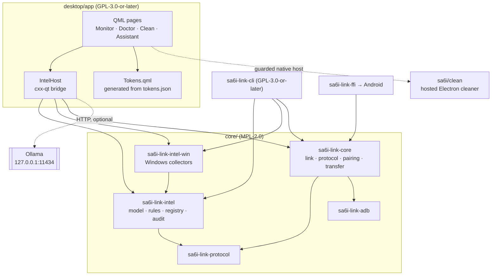

# Module map and dependency rules

Solid arrows are compile-time dependencies; the dashed edge is runtime only.

## Rules

1. **`sa6i-link-intel` never depends on Windows, Qt or HTTP.** It owns the model,
   the rule engine, the action registry and the audit format. Everything that
   touches an OS or a socket implements a trait it defines.
2. **`sa6i-link-intel-win` depends on `intel` and on the `windows` crate, never
   on `core`.** Diagnostics must not require a phone, a pairing or a transport.
3. **`core` does not know `intel` exists.** Link features keep working exactly as
   they do today; they gain entries in the capability matrix, not dependencies.
4. **The shell depends on both, and neither depends on the shell.** No QML type is
   ever referenced from Rust core, so the CLI keeps working headless.
5. **`sa6i/clean` stays behind its existing guard** and is reached only through
   the native host adapter; the intelligence core may *recommend* opening it, and
   nothing more.
6. **The model is an HTTP leaf.** Ollama, or any cloud provider, is reached only
   from the shell's explainer, never from core crates — so a private build can be
   shipped with the provider code compiled out.
7. **Generated files are one-way**: `tokens.json` → `Tokens.qml` / `Tokens.kt`.
   Nothing hand-edits those, and CI's `xtask tokens --check` enforces it.
8. **Licence direction**: GPL crates may depend on MPL crates, never the reverse;
   `deny.toml` already encodes this and CI runs it.

## Why this shape

The tempting alternative — put telemetry inside `sa6i-link-core` — would make
every diagnostics fix a protocol-adjacent change, force the Android FFI surface to
grow for desktop-only features, and make "does Doctor work without a phone?" a
runtime question. Splitting at the trait boundary makes it a compile-time fact:
`intel` has no transport dependency to satisfy, and the CLI proves it every time
it runs.

## Module status in this architecture

| Module | Engine | Depends on | Status |
| --- | --- | --- | --- |
| Doctor | `intel` rules over `intel-win` collectors | — | **partial** — 3 rules with fixtures; the connection-only `doctor.rs` in core is separate |
| Monitor | `intel` model + collectors | — | **partial** — model, store and CPU/memory/volume/uptime collectors done; no page yet |
| Clean | `intel` scan (native) + hosted fallback | action registry | **partial** (hosted only) |
| Link | `core` | — | **verified** |
| Security | `intel-win` readers | — | **not implemented**, several readings **technically uncertain** without admin |
| Assistant | explainer over `intel` findings | Ollama (runtime, optional) | **not implemented** |
